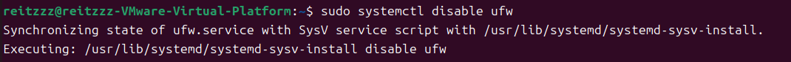
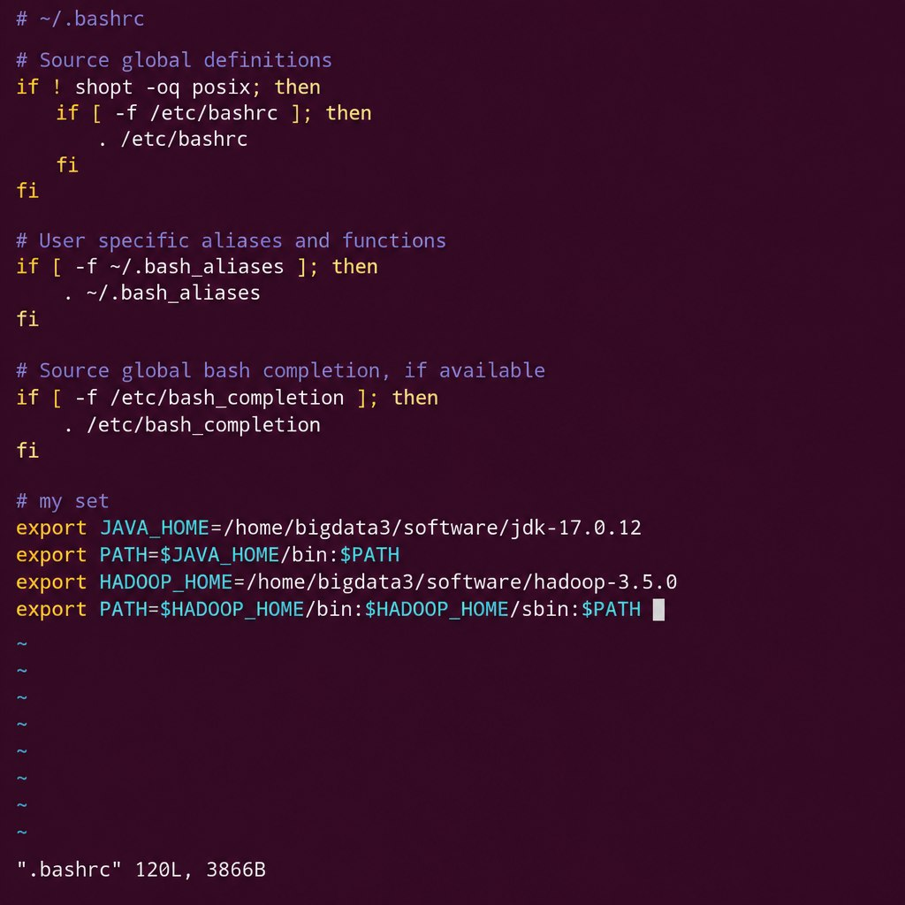
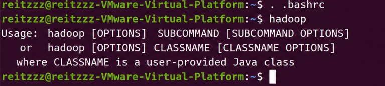
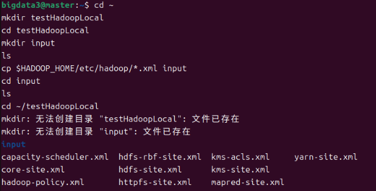
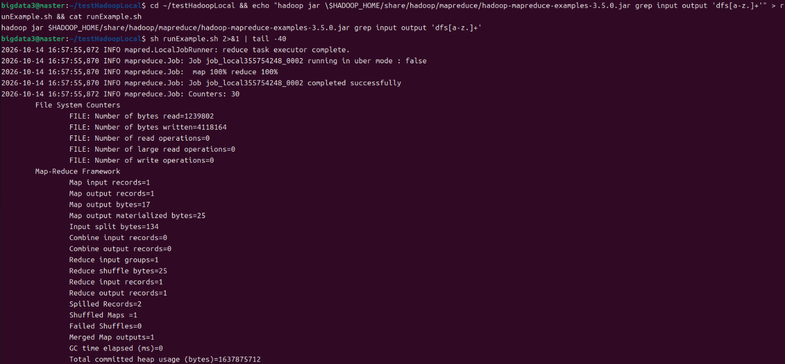
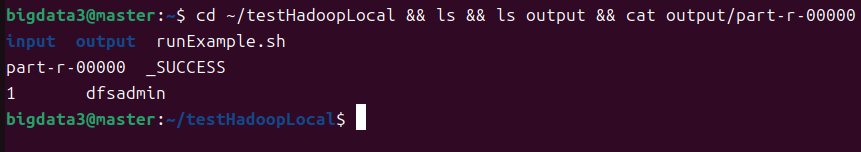
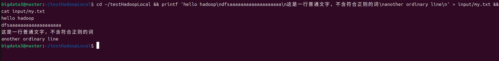
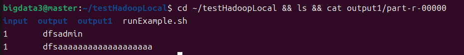

# 建立并验证 hadoop 的 local 模式

本次上机（9.30 – 10.14）的内容：装好 jdk 和 hadoop，配好环境变量，验证 `java`、`hadoop` 命令可用。

用到的机器有两台，注意区分：

- **本地 VMware 虚拟机**：主机名 `reitzzz-VMware-Virtual-Platform`，用户 `reitzzz`。在这里做环境准备（关防火墙、装 sshd）。
- **集群 master 节点**：主机名 `master`，用户 `bigdata3`，软件统一放在 `~/software`（= `/home/bigdata3/software`）。jdk 和 hadoop 都装在这里。

编号按你笔记的写法：「安装 hadoop local 模式」是 1.4（课程文档里是 1.3，解压 hadoop 1.3.1 / 配置 hadoop 1.3.2），所以解压是 1.4.1、配置是 1.4.2；「测试 hadoop local 模式」是 1.5（课程文档里是 1.4）。

## 1 建立 hadoop 的 local 模式

### 1.1 关闭防火墙 ufw（本地 VMware 虚拟机）

Ubuntu 默认启用 ufw（Uncomplicated firewall），它会拦截 hadoop 各组件之间通信所用的端口，所以在搭建之前先把它关掉。

**1) 查看当前状态**

```sh
sudo systemctl status ufw
```


输出中 `Loaded: ... enabled` 表示 ufw 服务已设为开机自启，`Active: active (exited)` 表示它当前处于活动状态（ufw 是一次性服务，加载完规则后即以 exited 状态结束，这是正常的）。`Main PID: 457 (code=exited, status=0/SUCCESS)` 说明服务正常退出。

**2) 禁用开机自启**

```sh
sudo systemctl disable ufw
```



输出里的 `Synchronizing state of ufw.service with SysV service script with /usr/lib/systemd/systemd-sysv-install` 是 systemd 在同步兼容的 SysV 启动脚本，属于正常提示，不是报错。

**3) 验证**

```sh
sudo ufw status
```


输出 `状态：不活动`，说明防火墙已经关闭。

> 注意：`systemctl disable` 取消的是 ufw 的开机自启；如果当前会话里防火墙仍是活动状态，还需要执行 `sudo ufw disable` 立即关闭。

### 1.2 安装 sshd、首次 ssh 连接（本地 VMware 虚拟机）

hadoop 的启动脚本需要 ssh 登录到各个节点去启动守护进程，因此先确认 openssh-server 可用。

**1) 安装 openssh-server**

```sh
sudo apt install openssh-server
```


本机此前已经安装过，apt 提示 `openssh-server 已经是最新版（1:9.6p1-3ubuntu13.19）`，无需重复安装。

**2) 首次 ssh 连接集群节点**

```sh
ssh 172.21.2.5
```


第一次连接该主机时，ssh 会提示无法确认对方身份，并给出 ED25519 密钥指纹：

```
The authenticity of host '172.21.2.5 (172.21.2.5)' can't be established.
ED25519 key fingerprint is SHA256:gKZAbI+RWM3m7Ei2NLzSJhgS9ZkzzJxNuwWkAhxw9jI.
```

确认指纹无误后输入 `yes`，该主机就会被写入 `~/.ssh/known_hosts`，之后连接不再提示。

### 1.3 安装 jdk（集群 master 节点）

课程文档里写：不能直接用 apt 推荐的方式安装，因为 **apt 安装的 jdk 内容不全，无法用于开发**；正确做法是下载完整的 jdk 包，解压后配置路径。

**1) 确认 java 情况**

虚拟机上 apt 装的 jdk 是可用的：

```sh
java -version
```


```
openjdk version "17.0.20.1" 2026-08-18
OpenJDK Runtime Environment (build 17.0.20.1+1-1-24.04-Ubuntu)
OpenJDK 64-Bit Server VM (build 17.0.20.1+1-1-24.04-Ubuntu, mixed mode, sharing)
```

而 master 节点上还没有 java：

```
bigdata3@master:~$ java -version
Command 'java' not found, but can be installed with:
sudo apt install openjdk-17-jre-headless  # version 17.0.19+10-1-24.04.2, or
sudo apt install openjdk-21-jre-headless  # version 21.0.11+10-1-24.04.2
sudo apt install default-jre              # version 2:1.17-75
……
```

**2) 解压 jdk 压缩包**

压缩包放在 `~/software` 下，与 hadoop 的安装包同目录：

```sh
cd ~/software
tar -zxvf jdk-17.0.12_linux-x64_bin.tar.gz
```

解压出 `jdk-17.0.12` 目录。

**3) 配置环境变量**

在 `~/.bashrc` 末尾添加两项：`JAVA_HOME` 指向 jdk 根目录，并把 `$JAVA_HOME/bin` 加进 `PATH`。

```sh
# my set
export JAVA_HOME=/home/bigdata3/software/jdk-17.0.12
export PATH=$JAVA_HOME/bin:$PATH
```

保存退出后，新打开一个终端，或者在当前终端重新装载 .bashrc（用 `source` 或 `.`）：

```sh
. ~/.bashrc
```

**4) 验证**

```sh
java -version
```

```
java version "17.0.12" 2024-07-16 LTS
Java(TM) SE Runtime Environment (build 17.0.12+8-LTS-286)
Java HotSpot(TM) 64-Bit Server VM (build 17.0.12+8-LTS-286, mixed mode, sharing)
```

版本是 17.0.12（压缩包里的版本），说明 `PATH` 已经指向新装的 jdk，环境变量配置生效。

### 1.4 安装 hadoop local 模式（集群 master 节点）

hadoop 也不用 apt 装，同样是下载官方压缩包后解压使用：解压出来的目录就是后面要配的 `HADOOP_HOME`。

#### 1.4.1 解压 hadoop

**1) 进入软件目录，确认压缩包在**

```sh
cd ~/software
ls
```

此时应该能看到 `hadoop-3.5.0.tar.gz`（`ls` 里如果已经有 `hadoop-3.5.0` 目录，说明之前解压过了）。

**2) 解压**

```sh
tar -zxvf hadoop-3.5.0.tar.gz
```

参数含义：

- `-z`：按 gzip 处理（压缩包后缀是 `.gz`）
- `-x`：解压
- `-v`：显示解压过程
- `-f`：指定后面跟的文件名

解压默认就地展开到当前目录，不需要另外指定目标路径。

**3) 验证**

```sh
ls
```

解压后会多出一个 `hadoop-3.5.0` 目录，目录名就是压缩包去掉 `.tar.gz`：

```
hadoop-3.5.0  hadoop-3.5.0.tar.gz  jdk-17.0.12  jdk-17.0.12_linux-x64_bin.tar.gz
```

看到 `hadoop-3.5.0` 目录即为解压成功。该目录的绝对路径 `/home/bigdata3/software/hadoop-3.5.0` 就是下一步 `HADOOP_HOME` 要填的值。

#### 1.4.2 配置 hadoop

在 `~/.bashrc` 中配置两项：

- 新建一个环境变量 `HADOOP_HOME`
- 在 `PATH` 中添加 `hadoop/bin` 和 `hadoop/sbin`

```sh
export HADOOP_HOME=/home/bigdata3/software/hadoop-3.5.0
export PATH=$HADOOP_HOME/bin:$HADOOP_HOME/sbin:$PATH
```

加上前面 jdk 的配置，`~/.bashrc` 末尾这一段是：

```sh
# my set
export JAVA_HOME=/home/bigdata3/software/jdk-17.0.12
export PATH=$JAVA_HOME/bin:$PATH
export HADOOP_HOME=/home/bigdata3/software/hadoop-3.5.0
export PATH=$HADOOP_HOME/bin:$HADOOP_HOME/sbin:$PATH
```



*图示：在 .bashrc 末尾配置 HADOOP_HOME 和 PATH*

重新装载 .bashrc 后测试：

```sh
. ~/.bashrc
hadoop
```

```
Usage: hadoop [OPTIONS] SUBCOMMAND [SUBCOMMAND OPTIONS]
 or    hadoop [OPTIONS] CLASSNAME [CLASSNAME OPTIONS]
  where CLASSNAME is a user-provided Java class
```



*图示：hadoop 命令可用（打出 Usage）*

能打出 Usage 说明 `hadoop` 命令已经可用（`PATH` 生效），local 模式的安装部分完成。


### 1.5 测试 hadoop local 模式

（课程文档里这一部分是 1.4）

用官方自带的示例程序来验证 local 模式能跑通：示例包是 `hadoop-mapreduce-examples-3.5.0.jar`，在 `$HADOOP_HOME/share/hadoop/mapreduce/` 下，本次用的是里面的 `grep` 例子。

#### 1.5.1 新建目录，拷贝文件

在 master 上建一个测试用的工作目录 `~/testHadoopLocal`，在里面建 `input` 目录：

```sh
cd ~/testHadoopLocal
mkdir input
ls
```

```
bigdata3@master:~/testHadoopLocal$ mkdir input
bigdata3@master:~/testHadoopLocal$ ls
input
```

把 hadoop 配置目录下的 xml 文件当作输入数据拷进 `input`：

```sh
cp etc/hadoop/*.xml input
```

这条会报错——当前目录 `~/testHadoopLocal` 下面没有 `etc`，得用 `$HADOOP_HOME` 拼出绝对路径：

```
cp: cannot stat 'etc/hadoop/*.xml': No such file or directory
```

换成下面的写法就对了：

```sh
cp $HADOOP_HOME/etc/hadoop/*.xml input
cd input
ls
```

```
bigdata3@master:~/testHadoopLocal/input$ ls
capacity-scheduler.xml  hadoop-policy.xml  hdfs-site.xml   kms-acls.xml   mapred-site.xml
core-site.xml           hdfs-rbf-site.xml  httpfs-site.xml kms-site.xml   yarn-site.xml
```

一共 10 个 xml 文件，拷贝成功。



*图示：建好 `input` 目录、把 `$HADOOP_HOME/etc/hadoop/*.xml` 拷进去后，`ls` 看到 10 个 xml 文件*

#### 1.5.2 新建一个脚本文件，运行 hadoop 程序

新建一个脚本文件（比如 `runExample.sh`，放在 `~/testHadoopLocal` 下），文件内容是运行官方 `grep` 示例的命令：

```sh
hadoop jar $HADOOP_HOME/share/hadoop/mapreduce/hadoop-mapreduce-examples-3.5.0.jar grep input output 'dfs[a-z.]+'
```

其中 `input`、`output` 是相对于脚本所在目录（`~/testHadoopLocal`）的两个目录名，`'dfs[a-z.]+'` 是要统计的正则表达式。

写好后在 `~/testHadoopLocal` 下运行这个脚本：

```sh
sh runExample.sh
```

运行时会先打出一大段 mapreduce 日志，最后是各类计数器，例如（片段）：

```
	Shuffled Maps =1
	Failed Shuffles=0
	Merged Map outputs=1
	GC time elapsed (ms)=8
	Total committed heap usage (bytes)=1233125376
	Shuffle Errors
		BAD_ID=0
		CONNECTION=0
		IO_ERROR=0
		WRONG_LENGTH=0
		WRONG_MAP=0
		WRONG_REDUCE=0
	File Input Format Counters
		Bytes Read=123
	File Output Format Counters
		Bytes Written=23
```



*图示：`cat runExample.sh` 看到脚本内容，以及 `sh runExample.sh` 运行到结尾的计数器（`map 100% reduce 100%`、`completed successfully`）*

#### 1.5.3 查看结果

回到工作目录，能看到跑完多了一个 `output` 目录：

```sh
ls
```

```
bigdata3@master:~/testHadoopLocal$ ls
input  output  runExample.sh
```

结果在 `output` 下：`part-r-00000` 是 reduce 的输出文件，`_SUCCESS` 是任务成功的空标记文件。

```sh
cd output/
ls
```

```
bigdata3@master:~/testHadoopLocal/output$ ls
part-r-00000  _SUCCESS
```

看结果文件的内容：

```sh
cat part-r-00000
```

```
bigdata3@master:~/testHadoopLocal/output$ cat part-r-00000
1	dfsadmin
```

只有一行：前一个数是词频，后面是匹配 `dfs[a-z.]+` 命中的词（`dfsadmin`）。第一次运行官方示例就出了结果，local 模式算是跑通了。



*图示：`ls` 看到跑完多出的 `output` 目录，`cat output/part-r-00000` 得到 `1 dfsadmin`*

#### 1.5.4 在输入目录添加一个新文件，再次运行程序

在 `input` 目录里新建 `my.txt`，里面既有符合正则 `dfs[a-z.]+` 的内容，也有不符合的内容：

```sh
cd input
vim my.txt
cd ..
```

`my.txt` 里的内容：

```
hello hadoop
dfsaaaaaaaaaaaaaaaaaaa
这是一行普通文字，不含符合正则的词
another ordinary line
```



*图示：`input/my.txt` 的四行内容*

四行里只有 `dfsaaaaaaaaaaaaaaaaaaa` 这个词整体符合 `dfs[a-z.]+`（所以统计出来是 1 次），其余几行都不会被匹配到。

hadoop 不会往已经存在的输出目录里写（第一次运行已经生成了 `output`，再跑到同名目录会报目录已存在），所以要先把脚本里的输出路径改掉，把 `output` 改成 `output1`：

```sh
vim runExample.sh
```

改完之后的脚本内容：

```sh
hadoop jar $HADOOP_HOME/share/hadoop/mapreduce/hadoop-mapreduce-examples-3.5.0.jar grep input output1 'dfs[a-z.]+'
```


*图示：修改后的 `runExample.sh`，输出目录由 `output` 改成 `output1`*

再运行一次：

```sh
sh runExample.sh
```

```
                     Bytes Written=48
bigdata3@master:~/testHadoopLocal$ ls
input  output  output1  runExample.sh
bigdata3@master:~/testHadoopLocal$ cd output1
bigdata3@master:~/testHadoopLocal/output1$ ls
part-r-00000  _SUCCESS
bigdata3@master:~/testHadoopLocal/output1$ cat part-r-00000
1	dfsadmin
1	dfsaaaaaaaaaaaaaaaaaaa
```

结果从一行变成两行：新加的 `my.txt` 里那个符合正则的词（`dfsaaaaaaaaaaaaaaaaaaa`）也被统计进来了，不符合正则的内容没有出现在结果里——说明 grep 示例确实是按正则筛选的。


*图示：改用 `output1` 后再次运行 `sh runExample.sh`（`Bytes Read` 由 123 增至 162，对应输入里多了一个文件）*



*图示：`ls` 看到 `output` 和 `output1` 并存，`cat output1/part-r-00000` 得到两行结果*
