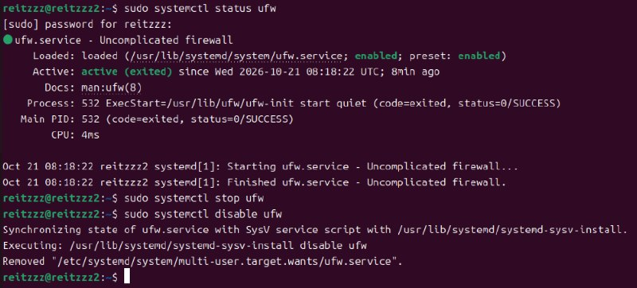
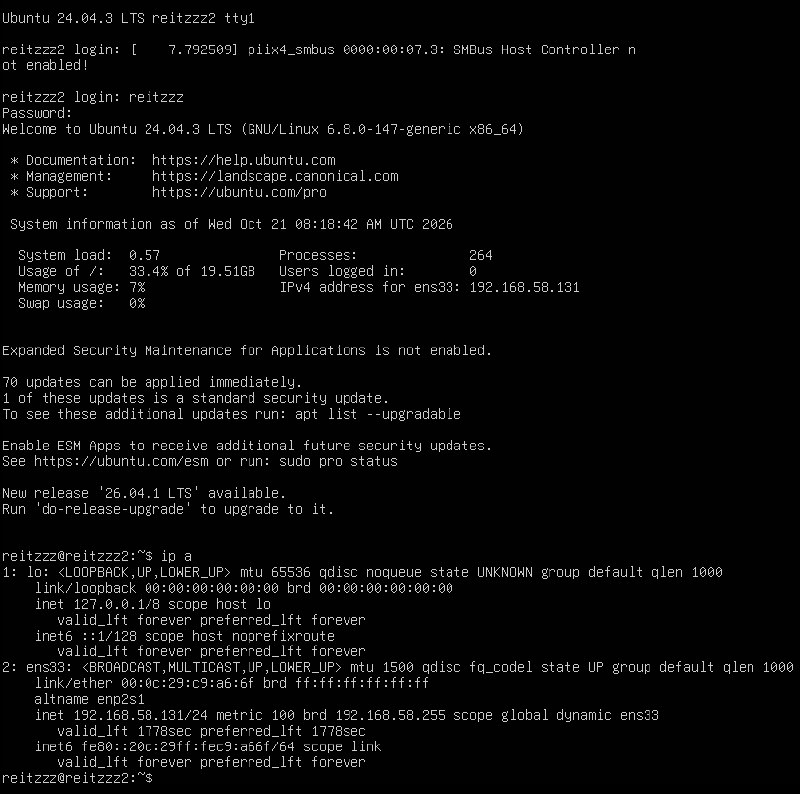
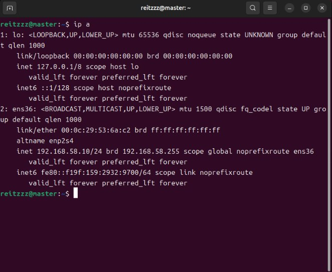

# hadoop集群配置

## 1 基本概念

hadoop集群由几个至数千个节点构成，节点功能：

* namenode：名字节点，针对的是HDFS，保存的是目录结构（包括：目录树、目录名、文件名、目录和文件属性等）和数据块的URL和校验值，不保存具体内容。
* datanode：数据节点，针对的是HDFS，保存的是文件的内容具体。
* resourcemanager：资源管理器yarn的资源管理服务。
* nodemanager：yarn的节点管理服务。

## 2 节点分配

典型的，最少节点数是3，可以这样分配节点功能：

* master节点：namenode和resourcemanager，其他辅助功能，例如web页面和任务管理
* workers节点：先分配两个物理节点 reitzzz1、reitzzz2，功能是datanode和nodemanager，初步概念理解后，将扩展到3个节点。

## 3 节点准备

### 3.1 准备3个Linux节点

### 3.2 修改节点的计算机名

hadoop要求：计算机名必须与域名一致，我们使用本地域名。

两个方法：

1) 编辑法

命名：

```sh
sudo vim /etc/hostname
```

将文件中的内容改成需要的计算机名。

2) 文件内容覆盖法

命名：

```sh
sudo sh -c "echo 计算机名 >/etc/hostname"
```

修改后重启生效。


### 3.3 所有节点建立相同的用户名

### 3.4 所有节点关闭防火墙

#### 3.4.1 master

命令：

```sh
sudo systemctl status ufw
```


防火墙已经关闭，并且disable。

#### 3.4.2 reitzzz1


当前active，并且enable，所以需要stop，然后disable。

<!-- TODO: 补一张 reitzzz1 执行 stop 与 disable 之后的截图 -->

#### 3.4.3 reitzzz2



当前active，并且enable，所以需要stop，然后disable。

<!-- TODO: 补一张 reitzzz2 执行 stop 与 disable 之后的截图 -->

### 3.5 配置固定ip地址

当前路由配置：

子网：192.168.58.0　子网掩码：255.255.255.0　网关：192.168.58.2

DHCP地址范围：192.168.58.128~192.168.58.254

网络规划：

* master：192.168.58.10
* reitzzz1：192.168.58.11
* reitzzz2：192.168.58.12

改之前 master 是 DHCP 动态地址：


reitzzz2 同样是动态地址：



#### 3.5.1 master

master是desktop版，最好使用图形界面设置：

网络设置：


测试：



#### 3.5.2 reitzzz1

reitzzz1 没有图形界面，用 netplan 改。先看 /etc/netplan 下有哪些文件，再编辑：

```yaml
network:
  version: 2
  renderer: networkd
  ethernets:
    ens33:
      dhcp4: false
      addresses:
        - 192.168.58.11/24
      routes:
        - to: default
          via: 192.168.58.2
      nameservers:
        addresses: [172.16.3.8]
```

编辑 /etc/netplan 下的文件：

<!-- TODO: 补一张 /etc/netplan/*.yaml 编辑后的截图 -->

保存退出后，使网络配置生效，执行

```sh
sudo netplan apply
```

有错误，重新配置：

<!-- TODO: 补一张 netplan apply 报错/重配的命令与输出 -->

### 3.6 配置本地域名

### 3.7 配置时钟同步
