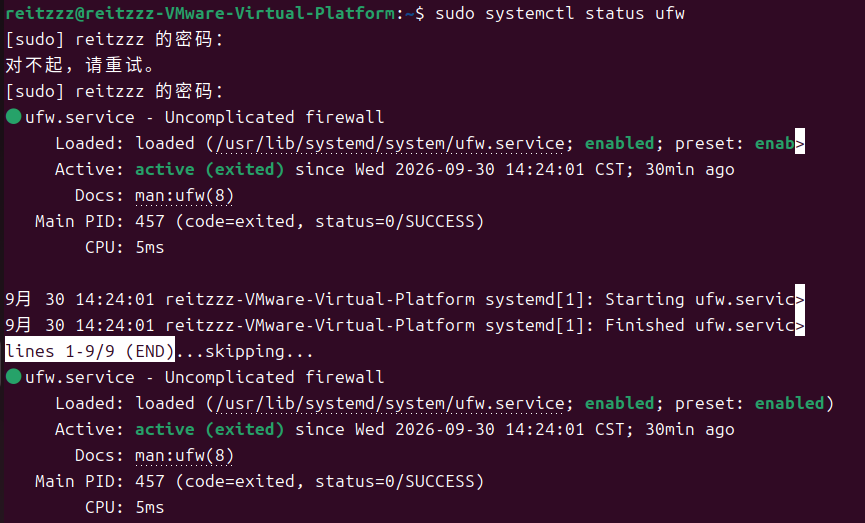
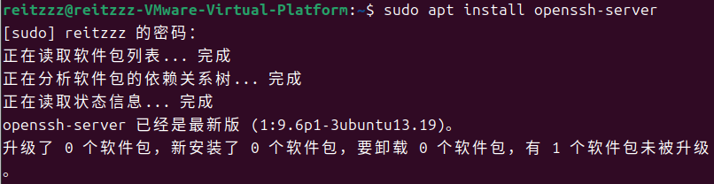
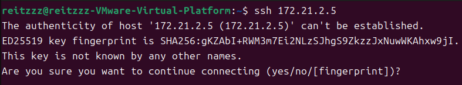

# 9.30 Hadoop local 模式环境准备

本文记录 2026-09-30 在 Ubuntu 虚拟机（VMware，主机名 `reitzzz-VMware-Virtual-Platform`，用户 `reitzzz`）上，为搭建 Hadoop local 模式做的三项准备工作：关闭防火墙、安装 sshd、安装 JDK。每一步都给出执行的命令、实际输出和验证结果。

## 1 关闭防火墙 ufw

Ubuntu 默认启用 ufw（Uncomplicated firewall），它会拦截 Hadoop 各组件之间通信所用的端口，所以在搭建之前先把它关掉。

### 1.1 查看防火墙当前状态

```sh
sudo systemctl status ufw
```



输出中 `Loaded: ... enabled` 表示 ufw 服务已设为开机自启，`Active: active (exited)` 表示它当前处于活动状态（ufw 是一次性服务，加载完规则后即以 exited 状态结束，这是正常的）。`Main PID: 457 (code=exited, status=0/SUCCESS)` 说明服务正常退出。

### 1.2 禁用 ufw 开机自启

```sh
sudo systemctl disable ufw
```


输出里的 `Synchronizing state of ufw.service with SysV service script with /usr/lib/systemd/systemd-sysv-install` 是 systemd 在同步兼容的 SysV 启动脚本，属于正常提示，不是报错。

### 1.3 验证

```sh
sudo ufw status
```


输出 `状态：不活动`，说明防火墙已经关闭。

> 注意：`systemctl disable` 取消的是 ufw 的开机自启；如果当前会话里防火墙仍是活动状态，还需要执行 `sudo ufw disable` 立即关闭。

## 2 安装 sshd

Hadoop 的启动脚本需要 SSH 登录到各个节点去启动守护进程，因此要先保证 openssh-server 可用。

### 2.1 安装 openssh-server

```sh
sudo apt install openssh-server
```



本机此前已经安装过，apt 提示 `openssh-server 已经是最新版（1:9.6p1-3ubuntu13.19）`，无需重复安装。

### 2.2 首次 SSH 连接目标主机

```sh
ssh 172.21.2.5
```



第一次连接该主机时，SSH 会提示无法确认对方身份，并给出 ED25519 密钥指纹：

```
The authenticity of host '172.21.2.5 (172.21.2.5)' can't be established.
ED25519 key fingerprint is SHA256:gKZAbI+RWM3m7Ei2NLzSJhgS9ZkzzJxNuwWkAhxw9jI.
```

确认指纹无误后输入 `yes`，该主机就会被写入 `~/.ssh/known_hosts`，之后连接不再提示。

## 3 安装 JDK

### 3.1 检查 java 是否可用

```sh
java -version
```


输出：

```
openjdk version "17.0.20.1" 2026-08-18
OpenJDK Runtime Environment (build 17.0.20.1+1-1-24.04-Ubuntu)
OpenJDK 64-Bit Server VM (build 17.0.20.1+1-1-24.04-Ubuntu, mixed mode, sharing)
```

JDK 17 已经装好并且可以直接运行。

### 3.2 待补

- 用压缩包（tarball）方式安装 JDK 时，解压后对 java 的验证
- 环境变量配置，需要配置两项：
  - 在 `PATH` 变量中添加 java 可执行文件的路径
  - 新建 `JAVA_HOME` 变量，值为 JDK 软件的根路径
